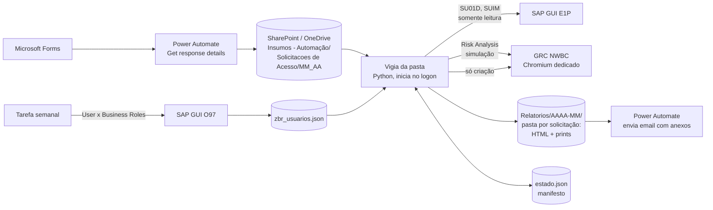

# User-management-forms: como a aplicação funciona

Análise de risco automática de pedidos de acesso SAP (sistema **E1P**, mandante **010**) feitos por um **Microsoft Forms**, com
**criação do usuário no GRC** apenas quando ele ainda não existe no SAP.

Criado em 17/11/2026. Estado: especificação e núcleo puro (validação, decisão, comparação de riscos, lista de ZBR, manifesto) com
testes. SAP (SUIM/SU01D/O97) e GRC (Risk Analysis e request) ainda não foram mapeados ao vivo: as portas existem, as implementações não.

---

## 1. Objetivo e regra de negócio

Alguém preenche o Forms pedindo uma ou mais **transações** (ex.: `FB01`) para um **IGG**. Para cada resposta a aplicação:

1. **Valida** a resposta (formato do IGG, das transações, remetente da organização, IGG protegido).
2. **Confere no E1P (somente leitura, SU01D)** se o usuário existe:
   - **Criação** e o usuário **já existe** no SAP → **não cria nada**, avisa no relatório (guarda de segurança).
   - **Modificação** e o usuário **não existe** → não analisa, avisa.
3. **Descobre as single roles** que dão cada transação: E1P › **SUIM**, relatório de roles por valor de autorização,
   objeto `S_TCODE` = transação (somente leitura). Caminho gravado pelo analista em 17/11/2026; detalhes em `suim.py`.
4. **Análise de risco no GRC** (somente leitura): *Access Management › User Level Simulation*, uma vez para cada single
   role candidata, sempre com **Rule Set `EP - SOD 2019`** (regra do analista) e a caixa **Risk from Simulation only**
   marcada: só entram os riscos que a role traz, não os que o usuário já tem (decisão do analista, 17/11/2026; no teste com
   FB01 isso tirou o CIT01_EP, que vinha de SE16N/SM35 do próprio usuário). O resultado é lido nos dois tipos
   (*Critical Action* e *Permission Level*). Qualquer risco (Critical, High, Medium ou Low) conta como **conflito**.
   Caminho mapeado ao vivo em 17/11/2026; detalhes em `grc_risco.py`.
5. **Compara** as candidatas (qual tem menos riscos, qual é a mais grave) e monta o relatório.
6. **Criação apenas:** cria no GRC a request de criação do usuário (`New or Change Account`) com o **ZBR do usuário de referência**.
7. **Relatório HTML** com o resultado e os **prints anexados**; aviso de conflito no assunto. Um fluxo do Power Automate envia
   o email para o analista (com CC fixo).

### O que é o ZBR
Cada usuário é atrelado a um **ZBR** (business role, ex.: `ZBRCOORD`). As roles são incluídas no ZBR, não no
usuário, e valem para todos que têm aquele ZBR. Na criação, o novo usuário recebe o **mesmo ZBR do usuário de referência**.
O ZBR **não é legível no E1P**: só no **O97** (GRC, `001 - O97 : GRC : Production`), no report de favoritos
*User x Business Roles Report*. Por isso há uma **lista semanal** de usuários ativos e seus ZBRs (seção 6).

---

## 2. Visão geral

- **Nuvem (Power Automate):** grava cada resposta como JSON e envia o relatório. Não executa Python.
- **Máquina local (Windows):** vigia a pasta, lê o SAP, roda a análise no GRC e cria a request. A ponte é a **pasta sincronizada
  do OneDrive** (mesmo padrão do lock-users e do sox-automation).

---

## 3. Disparo: vigia da pasta

O processamento acontece **quando chega uma resposta**, não em horário fixo. O SAP GUI e o Chromium só existem no PC do
analista, então o disparo é local:

- `python -m gestao_usuarios vigiar` fica aberto (tarefa do Windows **ao fazer logon**, janela oculta).
- A cada `vigia.intervalo_s` (padrão 30 s) lista a pasta de solicitações; **só age se houver JSON novo** (custo zero no resto
  do tempo). Varredura simples em vez de evento do sistema de arquivos: o OneDrive cria e renomeia arquivos de formas que fazem
  os eventos falharem ou repetirem.
- Instância única (arquivo de trava): duas vigias nunca processam a mesma resposta.
- Requisitos: PC ligado, usuário logado, **tela desbloqueada**, SAP Logon disponível e sessão do GRC válida no Chromium dedicado.
  Sessão do GRC expirada = a solicitação fica pendente e é retomada na próxima varredura depois do login.

---

## 4. Fluxo de uma solicitação

| # | Etapa | Fase no manifesto |
|---|---|---|
| 1 | Lê o JSON, registra no manifesto | `NOVA` |
| 2 | Guardas de segurança (seção 8). Falhou → `RECUSADA` (final) | `RECUSADA` |
| 3 | SU01D no E1P: existe? bloqueado? | — |
| 4 | Regra de existência (Criação × Modificação). Divergiu → aviso, final | `AVISO` |
| 5 | Criação: ZBR do usuário de referência pela lista (seção 6). Sem ZBR → aviso, final | `AVISO` |
| 6 | SUIM: single roles por transação. Transação sem single role → entra no relatório como "sem role" | — |
| 7 | GRC: simulação para cada single role candidata (export Excel + prints) | `ANALISADA` |
| 8 | Criação: request no GRC (seção 7) | `REQUEST_CRIADA` |
| 9 | Relatório gravado | `CONCLUIDA` |

A decisão (etapas 2, 4, 5 e 8) é uma **função pura** em `decisao.py`: entradas → ação. Não toca em SAP, GRC nem disco.

### Em qual usuário a simulação roda
- **Modificação:** no **IGG do usuário** (acesso atual + single role candidata).
- **Criação:** o IGG ainda não existe no SAP, então a simulação roda no **usuário de referência** (mesmo ZBR que o novo
  usuário receberá) + single role candidata. **[A confirmar com o analista]**

---

## 5. Comparação das single roles (`analise.py`)

Para cada transação, cada single role candidata recebe:

- total de riscos e contagem por nível (Critical, High, Medium, Low);
- o nível mais grave;
- riscos **novos** (que a simulação acrescenta em relação ao acesso atual), quando o GRC distingue.

Ordem de recomendação: menos riscos Critical, depois High, Medium, Low, depois total, depois nome. **Conflito = qualquer risco**
em qualquer candidata; o assunto do email ganha `CONFLITO`. A aplicação **recomenda**, não escolhe: a escolha da role é humana.

---

## 6. Lista de ZBR (`zbr.py`)

- **Tarefa semanal** (`python -m gestao_usuarios atualizar-zbr`): O97 › *User x Business Roles Report* para todos os usuários
  ativos → `Insumos - Automação/Gestao Usuarios/zbr_usuarios.json` (`{"gerado_em": ..., "usuarios": {"L1234567": ["ZBRCOORD"]}}`).
- Na criação, o ZBR vem dessa lista pelo IGG do usuário de referência.
- **Fallback:** se o IGG não está na lista (entrou depois da última atualização) ou a lista tem mais de `zbr.idade_max_dias`
  (padrão 8), roda o mesmo report só para aquele IGG.
- Mais de um ZBR para o mesmo IGG → aviso, sem request (um humano escolhe).

---

## 7. Request de criação no GRC

Só quando **tipo = Criação** e o usuário **não existe** no E1P (conferido na SU01D logo antes do Submit, de novo).

- Request Type `New or Change Account`, User = IGG, Functional Area `EP- BRAZIL`, User Group `BR-TEP`, sistema `E1PCLNT010`,
  ZBR do usuário de referência. **[Campos a mapear ao vivo]**
- Mesmo padrão do lock-users: localização por `ct` + rótulo, **releitura da tela** antes do Submit, sucesso só com a mensagem
  `the request number is N`, número gravado no manifesto, sem reenvio.
- **Dry-run é o padrão**: sem `--executar` nada é criado (o relatório mostra "criaria").
- Disjuntor `--max-requests` (padrão 3 por rodada).
- **Com conflito de risco: não cria a request**, avisa. **[A confirmar com o analista]**
- As single roles pedidas entram na mesma request? **[A confirmar]** Hoje: não; a request só cria o usuário com o ZBR.

---

## 8. Segurança

Na dúvida a aplicação **não age**: vira aviso no relatório e um humano decide.

| Guarda | Regra |
|---|---|
| **Origem da resposta** | Email do solicitante em domínio permitido (`seguranca.dominios_permitidos`) |
| **IGG válido** | Letra + 7 dígitos, para o usuário e para a referência; referência ≠ usuário |
| **IGG protegido** | `seguranca.igg_protegidos`: a aplicação nunca age sobre eles |
| **Transações válidas** | `^[A-Z][A-Z0-9_/]{1,19}$`, no máximo `seguranca.max_transacoes` (padrão 10) |
| **Criação só para usuário novo** | Existe no E1P → sem request, aviso (conferido de novo antes do Submit) |
| **SAP somente leitura** | SU01D, SUIM e o report do O97 só são lidos; nada é gravado no SAP |
| **GRC** | Risk Analysis só roda o relatório (nada é salvo). A única escrita é a request de criação |
| **Credenciais** | Nunca passam pelo código: SSO/login feito pelo analista na janela da automação |
| **SharePoint** | Só se grava em `Insumos - Automação` |

---

## 9. Relatório e email

- Pasta por solicitação: `Insumos - Automação/Relatorios Gestao Usuarios/AAAA-MM/AAAAMMDD_HHMMSS_<id>/` com `relatorio.html`
  e os prints (`.png`): SUIM com o resultado de cada transação, GRC com o resultado de cada simulação, GRC após o Submit.
- Assunto: `[gestao-usuarios] <Criação|Modificação> <IGG> - <OK|CONFLITO|AVISO>`.
- Fluxo do Power Automate (seção do `docs/forms-e-fluxos.md`): ao criar `relatorio.html`, lista os `.png` da mesma pasta,
  anexa e envia para o analista com CC fixo.

---

## 10. Componentes (código)

| Módulo | Responsabilidade | Estado |
|---|---|---|
| `resposta.py` | Lê o JSON do Power Automate → `Solicitacao` | pronto |
| `seguranca.py` | Guardas da seção 8 (funções puras) | pronto |
| `decisao.py` | Regras da seção 4 (função pura) | pronto |
| `analise.py` | Comparação das single roles (seção 5) | pronto |
| `zbr.py` | Lista de ZBR, idade, consulta | pronto |
| `manifesto.py` | Estado por solicitação em JSON | pronto |
| `processador.py` | Orquestra uma solicitação pelas portas | pronto (testado com simuladores) |
| `portas.py` | Interfaces `SapE1P`, `GrcRisco`, `GrcRequest`, `FonteZbr` | pronto |
| `sap_gui.py` | Sessão própria por sistema (E1P/O97), leitura de ALV e popups | pronto (não testado ao vivo) |
| `suim.py` | SUIM: transação → roles (caminho gravado + conferências de título, programa e popup) | validado ao vivo (FB01, 17/11/2026) |
| `sap_e1p.py` | SU01D no E1P (portar do lock-users) | a fazer |
| `sap_o97.py` | *User x Business Roles Report* | a fazer (mapear ao vivo) |
| `wd.py` | Web Dynpro do GRC: botões (com lista de proibidos), combos, critérios, leitura de tabela | pronto |
| `grc_risco.py` | User Level Simulation (Rule Set `EP - SOD 2019`), leitura de Critical Action e Permission Level | validado ao vivo (L1170904 + `Y-BRF-FB01-POST_DOCUMENT`, 17/11/2026) |
| `grc_request.py` | Request de criação `New or Change Account` (Playwright/CDP) | a fazer (mapear ao vivo) |
| `relatorio.py` | HTML + prints | a fazer |
| `vigia.py`, `__main__.py` | Varredura da pasta, CLI, códigos de saída | a fazer |

---

## 11. Pontos em aberto

1. Na criação, a simulação roda no usuário de referência? (seção 4)
2. Com conflito, a request de criação é bloqueada? (seção 7)
3. As single roles pedidas entram na request de criação? (seção 7)
4. Campos da request `New or Change Account` e onde o ZBR entra nela (mapear ao vivo).
5. Tela do *User x Business Roles Report* (O97) (mapear ao vivo, com prints).
6. **SUIM** validada ao vivo em 17/11/2026 (FB01, E1P/010): *Roles by Complex Selection Criteria* (RSUSR070) com
   `S_TCODE` = FB01 devolve 10 single roles (ex.: `Y-BRF-FB01-POST_DOCUMENT`). A análise usa as **single roles**
   (decisão do analista, 17/11/2026); composite que aparecer é ignorada com aviso.
7. **Roles ocultas.** O popup do F8 avisa *"523 roles with missing authorization not displayed"*: o usuário que roda não
   enxerga todas as roles, e o resultado pode estar incompleto. Hoje vira aviso no relatório; decidir se basta ou se a rotina
   deve rodar com outro usuário/autorização.
8. **Resultado com mais de 10 linhas** por tipo: a grade mostra 10 por tela e a paginação ainda não foi feita. Hoje a
   simulação para (análise incompleta, sem request), em vez de fingir que leu tudo.
