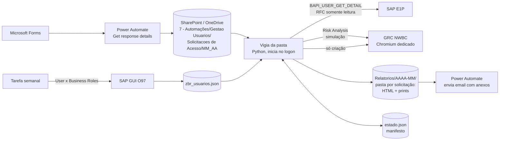

# User-management-forms: como a aplicação funciona

Análise de risco automática de pedidos de acesso SAP (sistema **E1P**, mandante **010**) feitos por um **Microsoft Forms**, com
**criação do usuário no GRC** apenas quando ele ainda não existe no SAP.

Criado em 17/11/2026. Estado (23/11/2026): a **modificação** roda de ponta a ponta ao vivo (SU01D → SUIM → simulação no GRC → relatório com os prints do GRC);
a lista de ZBR (O97) é atualizada toda segunda. Faltam a **request de criação** no GRC, o Forms e os fluxos do Power Automate, e a
vigia ligada no logon do Windows.

---

## 1. Objetivo e regra de negócio

Alguém preenche o Forms pedindo a **criação** de um usuário (IGG novo + usuário de referência) ou a **modificação** de um IGG
existente com uma ou mais **transações** (ex.: `FB01`). A criação **não pede transações**: o perfil é o ZBR da referência e o
o e-mail sai como `PARA CRIAR` (sem simulação de risco). **A criação abre o GRC** (`request.ligada: true`, religada em 26/11/2026 depois de
um dia desligada): em dry-run só ensaia o formulário, e o Submit exige `--executar`. **Desde 26/11/2026 o vigia roda em `--executar`** (tarefa
registrada com `agendar_vigia.ps1 -Executar`, pedido do analista para o primeiro caso real) com `request.max_por_rodada: 1`. Com `ligada: false` o e-mail é só o aviso. Para cada resposta a aplicação:

1. **Valida** a resposta (formato do IGG, das transações, remetente da organização, IGG protegido).
2. **Criação: confere no E1P (somente leitura, `BAPI_USER_GET_DETAIL` por RFC; SU01D por SAP GUI só com `sap.modo_usuario: gui`)** se o usuário existe: se **já existe** → **não cria nada**, avisa no relatório
   (guarda de segurança). **Modificação não confere nada no E1P** (analista, 25/11/2026: a análise de risco basta): sem SU01D, sem aviso
   de bloqueio e **sem abrir o SAP**; IGG inexistente aparece como falha da simulação no GRC.
3. **Descobre as single roles** que dão cada transação pelo **índice `roles_por_transacao.json`** (`roles.py`), gerado UMA vez da
   extração `ALL single roles X Transactions.XLSX` (tabela AGR_1251, objeto S_TCODE; `scripts/gerar_indice_roles.py`). A tabela quase não
   muda (analista, 25/11/2026): sem atualização automática nem alerta de idade. Linhas apagadas saem; `*` vale como prefixo; transação
   fora da tabela = aviso, nunca "sem risco". `roles.fonte: suim` volta à consulta ao vivo no E1P:
   E1P › **SUIM**, relatório de roles por valor de autorização,
   objeto `S_TCODE` = transação (somente leitura). Caminho gravado pelo analista em 17/11/2026; detalhes em `suim.py`.
   **Só as single roles que levam o nome da transação** (`Y-BRF-FB01-POST_DOCUMENT` e variantes como `..._BR02` para FB01; palavra
   inteira, sem diferenciar maiúsculas) entram na análise; se nenhuma levar o nome, valem todas as candidatas (decisão do analista,
   23/11/2026: evita análises desnecessárias). O relatório avisa quantas foram ignoradas.
4. **Análise de risco no GRC** (somente leitura, exceto a variante abaixo): *Access Management › User Level Simulation*, uma vez para cada single
   role candidata, sempre com **Rule Set `EP - SOD 2019`** (regra do analista) e a caixa **Risk from Simulation only**
   marcada: só entram os riscos que a role traz, não os que o usuário já tem (decisão do analista, 17/11/2026; no teste com
   FB01 isso tirou o CIT01_EP, que vinha de SE16N/SM35 do próprio usuário). O resultado é lido nos dois tipos
   (*Critical Action* e *Permission Level*). Qualquer risco (Critical, High, Medium ou Low) conta como **conflito**.
   Caminho mapeado ao vivo em 17/11/2026; detalhes em `grc_risco.py`.
   O resultado é lido tela a tela (10 linhas por tela, número absoluto no atributo `rr` das linhas) até ter 1..total sem
   buraco, com um print por tela; sem conseguir ler tudo, a análise fica incompleta e nenhuma request sai.
   O passo 1 usa a **variante salva `EP_SOD_2019_BRTEP`** (System E1PCLNT010, Rule Set EP - SOD 2019, Critical Action + Permission Level),
   criada uma vez por `scripts/criar_variante_grc.py` (única escrita no GRC além da request, autorizada em 25/11/2026). Escolher a variante
   troca o rótulo do assistente para *Risk Analysis :* (aceito só com a variante, conferindo o bloco *Simulation Criteria*); se a variante
   não existir, a rotina preenche tudo à mão como antes. O resultado é o mesmo (conferido ao vivo com FB01).
5. **Compara** as candidatas (qual tem menos riscos, qual é a mais grave) e monta o relatório.
6. **Criação apenas:** cria no GRC a request de criação do usuário (`New or Change Account`) com o **ZBR do usuário de referência**.
7. **Relatório HTML** com o resultado e os **prints anexados**; aviso de conflito no assunto. Um fluxo do Power Automate envia
   o email para o analista (com CC fixo).

### O que é o ZBR
Cada usuário é atrelado a um **ZBR** (business role, ex.: `ZBRCOORD`). As roles são incluídas no ZBR, não no
usuário, e valem para todos que têm aquele ZBR. Na criação, o novo usuário recebe o **mesmo ZBR do usuário de referência**.
O ZBR **não é legível no E1P**: só no **O97** (GRC, `001 - O97 : GRC : Production`), no report de favoritos
*User x Business Roles Report*. Por isso há uma **lista semanal** de usuários ativos e seus ZBRs (seção 6).

---

## 2. Visão geral

- **Nuvem (Power Automate):** grava cada resposta como JSON e envia o relatório. Não executa Python.
- **Máquina local (Windows):** vigia a pasta, lê o SAP, roda a análise no GRC e cria a request. A ponte é a **pasta sincronizada
  do OneDrive** (mesmo padrão do lock-users e do sox-automation).

---

## 3. Disparo: vigia da pasta

O processamento acontece **quando chega uma resposta**, não em horário fixo. O SAP GUI e o Chromium só existem no PC do
analista, então o disparo é local:

- `python -m gestao_usuarios vigiar` fica aberto: tarefa do Windows **`GestaoUsuarios-Vigia`, ao fazer logon**, janela oculta
  (`scripts/agendar_vigia.ps1` registra; `rodar_vigia.vbs` esconde a janela e espera; `rodar_vigia.cmd` lança o Python). Roda em
  **dry-run** (ensaia a request, sem Submit); `agendar_vigia.ps1 -Executar` troca para criar requests, só depois do primeiro
  caso real acompanhado. Sem limite de tempo; se cair, o Agendador reinicia (até 5 vezes, de 2 em 2 min). Logs:
  `logs/AAAA-MM-DD.log` e `logs/vigia_console.log`. Validada em 23/11/2026: pegou uma resposta em ~15 s, entregou o relatório
  em ~2 min, não reprocessou e uma segunda instância saiu com código 4.
- A cada `vigia.intervalo_s` (padrão 30 s) lista a pasta de solicitações; **só age se houver JSON novo** (custo zero no resto
  do tempo). Varredura simples em vez de evento do sistema de arquivos: o OneDrive cria e renomeia arquivos de formas que fazem
  os eventos falharem ou repetirem.
- Instância única (arquivo de trava): duas vigias nunca processam a mesma resposta.
- Requisitos: PC ligado, usuário logado, **tela desbloqueada**, SAP Logon disponível e sessão do GRC válida no Chromium dedicado.
  Sessão do GRC expirada = a solicitação fica pendente e é retomada na próxima varredura depois do login.

---

## 4. Fluxo de uma solicitação

| # | Etapa | Fase no manifesto |
|---|---|---|
| 1 | Lê o JSON, registra no manifesto | `NOVA` |
| 2 | Guardas de segurança (seção 8). Falhou → `RECUSADA` (final) | `RECUSADA` |
| 3 | Criação: `BAPI_USER_GET_DETAIL` no E1P por RFC (existe?). Modificação: não confere | — |
| 4 | Criação: se o usuário já existe → aviso, final | `AVISO` |
| 5 | Criação: ZBR do usuário de referência pela lista (seção 6). Sem ZBR → aviso, final | `AVISO` |
| 6 | SUIM: single roles por transação. Transação sem single role → entra no relatório como "sem role" | — |
| 7 | GRC: simulação para cada single role candidata (export Excel + prints). Criação sem transações pula os passos 6 e 7 | `ANALISADA` |
| 8 | Criação: request no GRC (seção 7) | `REQUEST_CRIADA` |
| 9 | Relatório gravado | `CONCLUIDA` |

A decisão (etapas 2, 4, 5 e 8) é uma **função pura** em `decisao.py`: entradas → ação. Não toca em SAP, GRC nem disco.

### Em qual usuário a simulação roda
- **Modificação:** no **IGG do usuário** (acesso atual + single role candidata).
- **Criação:** o IGG ainda não existe no SAP, então a simulação roda no **usuário de referência** (mesmo ZBR que o novo
  usuário receberá) + single role candidata. **[A confirmar com o analista]**

---

## 5. Comparação das single roles (`analise.py`)

Para cada transação, cada single role candidata recebe:

- total de riscos e contagem por nível (Critical, High, Medium, Low); o **quadro do relatório mostra só a coluna Críticos**, e o
  detalhe lista todos os riscos (decisão do analista, 23/11/2026; a decisão de conflito continua sendo qualquer risco);
- o nível mais grave;
- riscos **novos** (que a simulação acrescenta em relação ao acesso atual), quando o GRC distingue.

Ordem de recomendação: menos riscos Critical, depois High, Medium, Low, depois total, depois nome. **Conflito = qualquer risco**
em qualquer candidata; o assunto do email ganha `CONFLITO`. A aplicação **recomenda**, não escolhe: a escolha da role é humana.

---

## 6. Lista de ZBR (`zbr.py`, `sap_o97.py`)

- **Fonte:** O97 › *User x Business Roles Report* (transação `Z_USER_BR`, SAP Query `AQZZZGRCREPORTS=Z_USER_BR`), sempre com
  **User Group = BR-TEP** (a filial é só a BR-TEP, regra do analista de 19/11/2026) e **Connector Id = E1PCLNT010**. Sem o
  connector, o usuário traz também as business roles de BW (ex.: ZBRCO_KEYUSER, ZBR_COORD); com ele, sobra o ZBR do E1P.
  A última linha da grade é a de totais do ALV e é ignorada. Mapeado e validado ao vivo em 19/11/2026.
- **Atualização semanal:** tarefa do Windows **`GestaoUsuarios-Lista-ZBR`, segundas às 08:00** (escolha do analista,
  19/11/2026), registrada por `scripts/agendar_zbr.ps1` e lançada por `scripts/rodar_zbr.cmd` (log em `logs/tarefa_zbr.log`;
  só com o usuário logado e a tela desbloqueada; PC desligado no horário = roda assim que der). Ela executa
  `scripts/atualizar_zbr.py`: o report para todos da BR-TEP (229 usuários, 1 ZBR cada, ~9 s) →
  `7 - Automações/Gestao Usuarios/zbr_usuarios.json` (`{"gerado_em": ..., "usuarios": {"L1234567": ["ZBRCOORD"]}}`).
  Só ZBR vigente hoje (Valid From ≤ hoje ≤ Valid To). A lista nova só substitui a atual se não encolheu mais de 20%
  (extração vazia ou filtrada por engano não apaga a lista boa).
- Na criação, o ZBR vem dessa lista pelo IGG do usuário de referência.
- **Fallback:** se o IGG não está na lista (entrou depois da última atualização) ou a lista tem mais de `zbr.idade_max_dias`
  (padrão 8), roda o mesmo report só para aquele IGG.
- Mais de um ZBR para o mesmo IGG → aviso, sem request (um humano escolhe). Na extração de 19/11/2026 não houve nenhum caso.

---

## 7. Request de criação no GRC (`grc_request.py`)

> **Ligada** (`request.ligada: true`, padrão desde 26/11/2026). Com `false` a rotina não abre o GRC na criação, nem em dry-run: o
> resultado é `AcaoRequest.DESLIGADA` e o e-mail diz que a request não foi aberta (esteve assim em 25/11/2026).

Só quando **tipo = Criação** e o usuário **não existe** no E1P (SU01D lida no início, de novo antes de decidir e uma terceira vez
com o formulário já pronto, imediatamente antes do Submit). É a **única escrita** da aplicação no GRC.

**Formulário mapeado ao vivo em 23/11/2026 (sem submeter nada):** *Access Management › Access Request* (janela nova).
1. Request Type `New or Change Account`; Request For `Other`; Description (obrigatória); User = IGG + Enter.
2. O GRC puxa **First Name, Last Name e Email** (aba *User Details*; obrigatórios e **travados**). Para um IGG que o GRC não
   conhece eles ficam vazios e a request não seria aceita: a aplicação **barra** (`UsuarioSemDadosNoGrc`) e avisa.
3. Functional Area `EP- BRAZIL` e User Group Name `BR-TEP`. Têm de vir **antes** do Add (senão: *Enter the value of Functional
   Area before adding roles*).
4. Aba *User Access* › Add › **Role** › *Select Roles*: Role Type `Business Role` (o ZBR é uma Business Role), Role / Profile
   Name = ZBR › Search › exatamente 1 resultado › seta Add › OK. A linha do ZBR: Assignment = ZBR, Type `Business Role`,
   Valid To 31.12.9999, Provisioning Action `Assign`.
4a. **Acesso ao sistema** (corrigido em 26/11/2026; a request 681959 saiu só com o ZBR e o usuário ficou sem acesso ao E1P):
   Add › **System** › *Select Systems*: System = `E1PCLNT010` › Go › exatamente 1 linha › seta Add › OK. Segunda linha da grade:
   Assignment = System = `E1PCLNT010`, Type `System`, Valid To 30.12.9999, sem approver, Provisioning Action
   `Change & Unlock User` (igual à request 680271 feita à mão). Config: `ConfigGrcRequest.sistema/tipo_sistema/acao_sistema`.
5. Conferência antes do Submit: cabeçalho (tipo, IGG, área, grupo, descrição) e grade (**2 linhas**: ZBR e sistema E1P; tipo, ação,
   validade) contra o esperado; qualquer divergência barra (`RequestBarrada`). Print do formulário preenchido vai para o relatório.
6. Submit (único clique do projeto): sucesso só com a mensagem `the request number is N`; erro de validação (*Enter the value for
   ...*) vira aviso; Submit **sem** confirmação (`SubmitSemConfirmacao`) **nunca é repetido** (a request pode existir: conferir
   no Request Status) e o relatório avisa em destaque.

**Aprovação:** diferente do Lock/Update (efeito imediato), a atribuição da role de negócio tem **Assignment Approver** (o GRC
preenche, ex.: `J0025020(3)`): a request entra num workflow de aprovação e o usuário só nasce no SAP depois dele.

- **Dry-run é o padrão e também ensaia a request:** sem `--executar` o formulário do GRC é preenchido e conferido, o print é
  tirado e o **Submit não é clicado** (o relatório diz "ensaio da request"). Com `--executar` faz o Submit, sem pedir
  confirmação no console (a vigia roda sozinha; a proteção são as travas acima).
- Disjuntor `request.max_por_rodada` (padrão 3).
- **Com conflito de risco: não cria a request**, avisa (`request.bloquear_com_conflito`). **[A confirmar com o analista]**
- As single roles pedidas entram na mesma request? **[A confirmar]** Hoje: não; a request só cria o usuário com o ZBR.

---

### RFC (25/11/2026)

Roteiro e prova de conceito no vault (`10 Projetos/Automações fora do PC`). Aqui o RFC faz duas coisas, as duas só leitura:

- **Leitura do usuário da criação** (`sap.modo_usuario: rfc`, padrão): sem tela, sem SAP GUI, funciona com a tela bloqueada (o Kerberos
  só exige a sessão do Windows logada). Paridade ao vivo com a SU01D: usuário existente e inexistente deram o mesmo resultado. O
  primeiro `BAPI_USER_GET_DETAIL` de cada conexão leva ~25 s (carga da descrição da função); as seguintes, ~0,3 s. A conexão é aberta
  uma vez por rodada e só quando há criação. `modo_usuario: gui` volta à SU01D por SAP GUI.
- **Índice de roles** (`scripts/gerar_indice_roles.py --rfc`): lê a `AGR_1251` (`OBJECT = 'S_TCODE' AND FIELD = 'TCD' AND AGR_NAME LIKE
  'Y-BR%'`, só o Brasil) e compara com o índice atual. Conferido: 3.790 linhas, 1.079 roles e 2.355 transações, **idêntico** à extração
  da planilha. `Y-%` traria os 30 mil roles de todos os países: não usar.
- **Fica por GUI/navegador:** o report de ZBR do O97 (lista semanal e fallback) e o GRC; o usuário do analista não tem `S_RFC` no O97.

## 8. Segurança

Na dúvida a aplicação **não age**: vira aviso no relatório e um humano decide.

| Guarda | Regra |
|---|---|
| **Origem da resposta** | Email do solicitante em domínio permitido (`seguranca.dominios_permitidos`) |
| **IGG válido** | Letra + 7 dígitos, para o usuário e para a referência; referência ≠ usuário |
| **IGG protegido** | `seguranca.igg_protegidos`: a aplicação nunca age sobre eles |
| **Transações válidas** | `^[A-Z][A-Z0-9_/]{1,19}$`, no máximo `seguranca.max_transacoes` (padrão 10); obrigatórias só na Modificação |
| **Criação só para usuário novo** | Existe no E1P → sem request, aviso (conferido de novo antes do Submit) |
| **SAP somente leitura** | O usuário (RFC `BAPI_USER_GET_DETAIL`), a `AGR_1251` e o report do O97 só são lidos; nada é gravado no SAP. O RFC tem **lista fechada** de funções e tabelas (`rfc_sap.FUNCOES_PERMITIDAS`/`TABELAS_PERMITIDAS`): `BAPI_USER_LOCK`/`CHANGE` e qualquer outra são recusadas por código |
| **GRC** | Risk Analysis só roda o relatório (nada é salvo). A única escrita é a request de criação |
| **Credenciais** | Nunca passam pelo código: SSO/login feito pelo analista na janela da automação |
| **SharePoint** | Só se grava em `7 - Automações/Gestao Usuarios` (biblioteca 1.9 - SAP › 2 - Melhorias e Projetos) |

---

## 9. Relatório e email

- Pasta por solicitação: `7 - Automações/Gestao Usuarios/Relatorios/AAAA-MM/AAAAMMDD_HHMMSS_<id>/` com o HTML
  `AAAAMMDD_HHMMSS_<assunto>.html` (prints embutidos no corpo, com teto de 16 prints e ~4 MB) e os PNG originais. **Só os prints do
  GRC** entram (resultado de cada simulação e formulário da request): SU01D e SUIM **não geram print** (decisão do analista,
  23/11/2026; `SapE1PReal(tirar_prints=True)` liga de volta para depuração).
- **Dois formatos de e-mail** (`relatorio.py`), cada um com os seus elementos:
  - **Modificação:** *Solicitação de acesso SAP (E1P)*: tipo, IGG, transações, justificativa, solicitante, avisos, análise de risco
    (quadro de Críticos + detalhe) e os prints do GRC. Assunto: `[gestao-usuarios] Modificação <IGG> - <OK|CONFLITO|AVISO|RECUSADA> (<transações>)`.
  - **Criação:** *Pedido de criação de usuário SAP (E1P)*: **Pedido** (novo IGG, usuário de referência, ZBR a atribuir, justificativa,
    solicitante), **Conferências no E1P** (o novo usuário não existe? a referência existe? há um ZBR só?, cada uma com OK/NÃO/NÃO CONFIRMADO/
    não verificado) e **Resultado** (o que fazer: criar à mão com o ZBR X, ou o motivo do aviso). Sem transações nem análise de risco.
    Assunto: `[gestao-usuarios] Criação <IGG> - <PARA CRIAR|REQUEST CRIADA|AVISO|CONFLITO|RECUSADA> (ZBR <zbr> | ref. <referência>)`.
- Fluxo do Power Automate **"Gestao Usuarios - Relatorio por email"** (`docs/forms-e-fluxos.md`, seção 3): criado e **ligado** (testado em 23/11/2026);
  ao aparecer o HTML na pasta, envia o corpo por e-mail para o analista **com o Vinicius Monteiro em cópia** (desde 26/11/2026).

---

## 10. Componentes (código)

| Módulo | Responsabilidade | Estado |
|---|---|---|
| `resposta.py` | Lê o JSON do Power Automate → `Solicitacao` | pronto |
| `seguranca.py` | Guardas da seção 8 (funções puras) | pronto |
| `decisao.py` | Regras da seção 4 (função pura) | pronto |
| `analise.py` | Comparação das single roles (seção 5) | pronto |
| `zbr.py` | Lista de ZBR, idade, consulta | pronto |
| `manifesto.py` | Estado por solicitação em JSON | pronto |
| `processador.py` | Orquestra uma solicitação pelas portas | pronto (testado com simuladores) |
| `portas.py` | Interfaces `SapE1P`, `GrcRisco`, `GrcRequest`, `FonteZbr` | pronto |
| `sap_gui.py` | Sessão própria por sistema (E1P/O97), leitura de ALV e popups | pronto (não testado ao vivo) |
| `suim.py` | SUIM: transação → roles (caminho gravado + conferências de título, programa e popup) | validado ao vivo (FB01, 17/11/2026) |
| `scripts/conferir_candidato.py` | Pré-checagem de um IGG para o primeiro teste real da criação: RFC (não existe no E1P) + ensaio do formulário do GRC sem Submit (o GRC conhece a pessoa?) | validado com os dois casos negativos (25/11/2026) |
| `rfc_sap.py` | SAP NW RFC por `ctypes` (`sapnwrfc.dll` do SAP GUI, SNC com o usuário do Windows, sem senha): lista fechada de leitura, `ler_tabela` (RFC_READ_TABLE) | validado ao vivo (E1M e E1P, 25/11/2026) |
| `sap_e1p_rfc.py` | Porta SapE1P por RFC: `usuario()` = `BAPI_USER_GET_DETAIL` (inexistente = RETURN E/01/124; outro erro = leitura incerta) | validado ao vivo: paridade com a SU01D |
| `sap_e1p.py` | Porta SapE1P real: SU01D (só na criação) + SUIM opcional, sem prints | validado ao vivo (23/11/2026) |
| `roles.py` | Índice transação → single roles (leitor de XLSX só com a biblioteca padrão; JSON em `Gestao Usuarios`) | validado ao vivo (FB01, 25/11/2026) |
| `capturas.py` | Prints do SAP (HardCopy, 1280 px) e do GRC (recortados no conteúdo, até 1700 px, exibidos a 100% da largura no relatório) | pronto |
| `conexoes.py` | Conexões reais abertas sob demanda: sessão própria do E1P, Chromium dedicado (CDP), O97; falha no GRC para a rodada uma vez só | validado ao vivo |
| `rotina.py` | Uma rodada: respostas novas → análise → relatório → manifesto; falha de um pedido vira aviso | validado ao vivo (modificação) |
| `sap_o97.py` | *User x Business Roles Report*: um IGG (fallback) e a extração semanal da BR-TEP | validado ao vivo (19/11/2026) |
| `wd.py` | Web Dynpro do GRC: botões (com lista de proibidos), combos, critérios, leitura de tabela paginada | paginação validada ao vivo (139 linhas, 19/11/2026) |
| `grc_risco.py` | User Level Simulation (Rule Set `EP - SOD 2019`), leitura de Critical Action e Permission Level | validado ao vivo (L1170904 + `Y-BRF-FB01-POST_DOCUMENT`, 17/11/2026) |
| `grc_request.py` | Request de criação `New or Change Account` (usuário + Business Role ZBR), com ensaio sem Submit | formulário e rodada de criação validados ao vivo em dry-run, sem submeter (23/11/2026: IGG existente recusado; IGG inventado barrado por falta de nome/e-mail no GRC); **Submit nunca testado** |
| `relatorio.py` | Pasta por pedido: `relatorio.html` (gravado por último), `assunto.txt` e prints | validado ao vivo (modificação) |
| `__main__.py` | CLI: `rodada`, `processar` (JSON avulso), `vigiar` (varredura da pasta, instância única) | validado ao vivo (`processar` e `vigiar`, 23/11/2026) |

---

## 11. Pontos em aberto

1. Na criação, a simulação roda no usuário de referência? (seção 4)
2. Com conflito, a request de criação é bloqueada? (seção 7)
3. As single roles pedidas entram na request de criação? (seção 7)
4. **Teste real do Submit:** falta um IGG novo de verdade (que o GRC conheça, mas que não exista no E1P) para validar a
   leitura de First Name/Last Name/Email, o Submit e o que o GRC faz no Submit (análise de risco própria, popup de risk
   violation, aprovador). O Submit não foi testado.
4a. **Pessoa nova que o GRC não conhece:** o Forms não coleta nome e e-mail; se o GRC não os achar, a request é barrada e avisa.
   Decidir se o Forms passa a pedir nome e e-mail (e o código a preenchê-los) ou se o cadastro corporativo sempre os tem.
5. **Python da tarefa da lista de ZBR:** o repositório ainda não tem `.venv` próprio; a tarefa usa o Python do lock-users
   (`agendar_zbr.ps1 -Python`). Criar o `.venv` daqui (instala pacotes: pedir ao analista) e registrar a tarefa de novo.
6. **SUIM** validada ao vivo em 17/11/2026 (FB01, E1P/010): *Roles by Complex Selection Criteria* (RSUSR070) com
   `S_TCODE` = FB01 devolve 10 single roles (ex.: `Y-BRF-FB01-POST_DOCUMENT`). A análise usa as **single roles**
   (decisão do analista, 17/11/2026); composite que aparecer é ignorada com aviso.
7. **Roles ocultas.** O popup do F8 avisa *"523 roles with missing authorization not displayed"* (o usuário que roda não
   enxerga todas as roles). O analista decidiu em 23/11/2026 que **não é importante**: o aviso foi retirado do relatório.
8. **Login do Chromium dedicado.** A sessão do GRC vence e o login (Windows Hello) é do analista. Com a vigia rodando sozinha,
   um pedido que chega com a sessão vencida fica pendente e a vigia tenta de novo a cada 5 min; falta um aviso ao analista
   (email ou notificação) para ele saber que precisa entrar.
9. **Fluxos do Power Automate:** o do relatório por e-mail está **ligado e testado** (e-mail só para o analista, imagens ok) e uma regra
   do Outlook entrega o assunto `[gestao-usuarios]` na pasta *Automations › Gestão de usuários* (`docs/forms-e-fluxos.md`, seção 3).
   O que grava as respostas do Forms **depende do Forms**, que ainda não foi criado.
   não foi criado.
